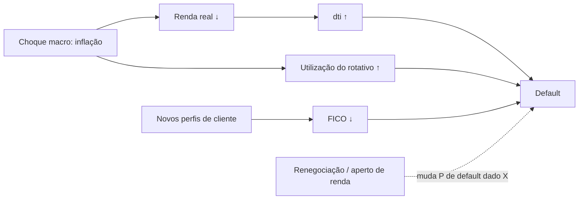

# Credit Scoring Observability

**Tech Challenge – Fase 04 | Pós-Tech em Machine Learning Engineering (FIAP)**

Projeto acadêmico de classificação binária de risco de crédito com o **All Lending Club Loan Data**: preparação de dados, Regressão Logística V2, contrato Pandera, simulação de drift, avaliação de performance, recomendações operacionais e observabilidade integrada.

> **Estado da entrega:** dados/modelo/contrato e monitoramento dos sete meses estão implementados. A observabilidade integra MLflow, Prometheus, Grafana, Loki e Tempo. O gate recomenda ações para revisão humana; não há treinamento ou promoção automática. Veja o [guia de entrega e reprodução](docs/delivery.md) e as [evidências da execução de referência](docs/evidencias/README.md).

## 1. Dataset e definição do problema

**Fonte:** [All Lending Club Loan Data, por wordsforthewise, no Kaggle](https://www.kaggle.com/datasets/wordsforthewise/lending-club).

Baixe o arquivo **`accepted_2007_to_2018Q4.csv`** e coloque-o em:

```text
data/raw/accepted_2007_to_2018Q4.csv
```

A pasta `data/` é ignorada pelo Git: nenhum CSV bruto ou gerado é distribuído diretamente neste repositório. Cada integrante deve obter sua cópia pela fonte indicada. Se o download vier compactado, extraia o `.csv` antes de rodar os notebooks. Os scripts (`make prepare`) aceitam também o `.csv.gz` e a pasta que o zip do Kaggle cria (`data/raw/accepted_2007_to_2018q4.csv/accepted_2007_to_2018Q4.csv.gz`).

O arquivo de empréstimos aceitos tem aproximadamente **2.260.701 registros e 151 colunas**. A população de modelagem tem **1.348.099 empréstimos** com desfecho conhecido e usa o seguinte target:

| Classe | Desfechos incluídos |
|---|---|
| `0`: não inadimplente | `Fully Paid`; `Does not meet the credit policy. Status:Fully Paid` |
| `1`: inadimplente | `Charged Off`; `Default`; `Does not meet the credit policy. Status:Charged Off` |

**Por que o mesmo prefixo aparece nas duas classes?** `Does not meet the credit policy`
é parte do status original do dataset e não define, sozinho, inadimplência.
O desfecho após `Status:` é diferente: `Fully Paid` indica quitação e entra
na classe 0; `Charged Off` indica baixa por perda e entra na classe 1.
A classificação segue [GOOD_STATUS e BAD_STATUS](src/credit_scoring_observability/preprocessing.py).
Esses empréstimos são mantidos na população do projeto; não representam uma
regra de aprovação atual nem tornam os dois desfechos equivalentes.

`Current`, `Late`, `In Grace Period` e registros sem `loan_status` ficam fora da modelagem porque não representam desfecho final conhecido. A prevalência da classe 1 é de aproximadamente **19,98%**.

**Limitações:** trata-se de dados históricos. A análise por ano de originação (`issue_d`) deve considerar o viés de maturação: empréstimos recentes ainda abertos não entram na população rotulada. O modelo é uma prova de conceito acadêmica, não um mecanismo validado para decisão real de concessão de crédito.

## 2. Como configurar o ambiente

**Recomendado:** Python 3.11 e [`uv`](https://docs.astral.sh/uv/). Execute os comandos na raiz do repositório:

```powershell
uv sync
make setup     # pre-commit + .env a partir do .env.example (defina PSEUDONYMIZATION_SALT)
make test      # testes com dados sintéticos, sem o CSV do Kaggle
```

Reprodução da Etapa 1 por scripts, sem abrir notebook (mesmos números dos notebooks 02–04):

```powershell
make prepare        # Referência (treino) × pool de produção (teste), pseudonimizados (~25 s)
make train          # modelo V2 + threshold em models/ (~1 min)
make demo-contract  # lote corrompido bloqueado pelo contrato: exit 2 + quarentena
make simulate       # sete lotes mensais + controle, calibração e demo
make analyze        # predições, HTML Evidently, comparação pareada e gate por mês
make help           # todos os alvos disponíveis
```

**Sem `make`** (comum no Windows), os mesmos alvos rodam direto com o `uv`:

| Alvo | Comando equivalente |
|---|---|
| `make setup` | `uv sync`, `uv run pre-commit install` e copiar `.env.example` para `.env` |
| `make lint` | `uv run ruff check .` e `uv run ruff format --check .` |
| `make test` | `uv run pytest` |
| `make prepare` | `uv run python -m credit_scoring_observability.prepare` |
| `make train` | `uv run python -m credit_scoring_observability.train` |
| `make simulate` | `uv run python -m credit_scoring_observability.simulation` |
| `make analyze` | `uv run python -m credit_scoring_observability.analyze` |
| `make validate BATCH=<arquivo>` | `uv run python -m credit_scoring_observability.validate --batch <arquivo>` |
| `make demo-contract` | `uv run python -m credit_scoring_observability.validate --demo-corrupted` |
| `make fairness` | `uv run python -m credit_scoring_observability.mitigation` |
| `make fairness-batches` | `uv run python -m credit_scoring_observability.fairness` |
| `make monitor` | `uv run python -m credit_scoring_observability.run_all` |
| `make causal` | `uv run python -m credit_scoring_observability.causal` |
| `make purge-quarantine` | `uv run python -m credit_scoring_observability.retention` |

O `uv sync` utiliza `pyproject.toml` e `uv.lock`. Para notebooks no VS Code, selecione o interpretador/kernel **`.venv/Scripts/python.exe`**. Se necessário, abra a pasta `notebooks/` e confirme que `Path('../data/raw/accepted_2007_to_2018Q4.csv').exists()` retorna `True` antes da leitura.

**Importante:** o `uv.lock` versionado deve acompanhar qualquer mudança de dependências. Se o `pyproject.toml` for editado, execute `uv lock` (ou `uv sync`) e inclua ambos no commit.

Para subir a infraestrutura de observabilidade da **Etapa 3** (requer Docker):

```powershell
# Sobe Prometheus, Grafana, MLflow, Loki, Tempo e Alloy (ou: make up-full)
docker compose --profile core --profile alerting --profile logs-traces up -d

# Executa o pipeline de lotes para gerar métricas e rastreios
uv run --env-file .env python -m credit_scoring_observability.run_all

# (Opcional) regenera monitoring/grafana/dashboard.json, provisionado ao subir a stack
uv run python scripts/generate_dashboard.py
```

## 3. Estrutura do projeto

```text
credit-scoring-observability/
├── data/                              # arquivos locais; não versionados
│   ├── raw/                           # CSV do Kaggle
│   ├── processed/                     # reference, reference_sample, production_pool (.parquet)
│   ├── production/                    # lotes mensais (Etapa 2) e o lote corrompido da demo
│   └── quarantine/                    # lotes bloqueados pelo contrato
├── models/                            # modelo (.joblib, local) e metadados/métricas (.json)
├── notebooks/                         # 01_eda … 05_data_contract
├── reports/contracts/                 # relatório JSON de cada lote validado (local)
├── reports/{drift,performance,gate,causal,metrics,monitoring}/  # saídas de make analyze/monitor (locais)
├── reports/fairness/                  # fairness_report.json (pool, versionado); fairness_by_batch.json (por lote simulado, versionado; make fairness-batches)
├── src/credit_scoring_observability/
│   ├── config.py · parameters.py      # caminhos, colunas e params.yaml validado
│   ├── logger.py                      # logs estruturados, customer_id mascarado
│   ├── preprocessing.py               # população, target, features derivadas, split
│   ├── prepare.py                     # Referência × pool, pseudonimização, região
│   ├── train.py · evaluate.py         # treino da V2, métricas e seleção de threshold
│   ├── registry.py                    # load_model(): pipeline + threshold versionado
│   ├── data_contract.py · validate.py # contrato Pandera, CLI de validação, quarentena
│   ├── simulation.py                  # lotes e intervenções reproduzíveis
│   ├── analyze.py · drift.py           # execução e estatísticas de drift
│   ├── performance.py · comparison.py # avaliação e comparação pareada
│   ├── gate.py · drift_report.py       # recomendações e HTML Evidently
│   ├── run_batch.py · run_all.py       # execução com observabilidade
│   ├── observation.py · metrics.py     # publicação e registro da execução
│   ├── causal.py                       # sensibilidade à restauração de marginais
│   ├── retention.py                    # descarte da quarentena após 30 dias (LGPD)
│   ├── fairness.py · mitigation.py     # viés por região; mitigação avaliada, não adotada
│   └── synthetic.py                    # dados sintéticos para testes
├── tests/                             # pytest, só com dados sintéticos
├── scripts/                           # k_anonymity, generate_dashboard, check_observability, freeze_evidence, build_delivery_package
├── monitoring/                        # prometheus (regras de alerta), grafana (dashboard provisionado), alertmanager, loki, tempo, alloy
├── docker-compose.yml                 # stack de observabilidade (profiles core, alerting, logs-traces)
├── docs/
│   ├── lgpd.md · model-card.md · postmortem.md · monitoring-plan.md · delivery.md
│   ├── evidencias/                    # execução de referência congelada (JSON, HTML, manifesto com hashes)
│   ├── decisions/                     # ADRs de drift e gate
│   ├── legado/                        # capturas de uma execução anterior (14/10)
│   └── guias/                         # guias do projeto anterior (referência conceitual)
├── .github/workflows/ci.yml           # lint + testes
├── Makefile · params.yaml · pyproject.toml · uv.lock
```

As pastas locais sob `data/` são criadas pelos notebooks e pelos scripts conforme necessário. Os diretórios `models/` e `docs/` podem conter também arquivos criados por outras frentes do projeto.

## 4. Observabilidade

Execute `make monitor` para processar os lotes com métricas, logs e traces.
`make analyze` usa o mesmo núcleo sem a instrumentação adicional.

- **Métricas:** snapshots por lote no Pushgateway, com cópia local em `reports/metrics/`.
- **Logs:** JSONL via structlog, coletado pelo Alloy e consultado no Loki.
- **Traces:** estágios instrumentados com OpenTelemetry e exportados ao Tempo.
- **MLflow:** versão, threshold, métricas e artefatos HTML/JSON agregados.
- **Correlação:** trace ID próprio do OpenTelemetry, relacionado ao run MLflow por tag.
- **Dashboard:** provisionado automaticamente no Grafana ao iniciar a stack.

O [guia de observabilidade](docs/observability-integration.md) explica os modos
local/Docker, portas, estados e como verificar a entrega aos serviços.

## 5. Ordem de execução dos notebooks

Abra os notebooks **em ordem**, com o kernel do ambiente do projeto. Eles pressupõem que `../data/` aponta para a pasta local de dados.

Os notebooks estão versionados **com as saídas** da execução de 21/10/2026 no ambiente do `uv.lock` (scikit-learn 1.9, pandas 3): métricas, tabelas e gráficos podem ser lidos no GitHub sem o dataset. Os números finais da V2 também estão em `models/*.json` e em [docs/evidencias/](docs/evidencias/README.md).

| Notebook | Objetivo e entregável |
|---|---|
| `01_eda.ipynb` | Análise global em chunks, definição de target, nulos, auditoria de features/leakage, análise numérica, categórica e temporal. |
| `02_preprocessing.ipynb` | Transformações determinísticas, split 80/20 estratificado, pré-processador e criação de `data/reference/reference_dataset.csv` (100.000 linhas do treino, com target e `issue_date`). |
| `03_baseline_model.ipynb` | Regressão Logística V1 em amostra estratificada de 300.000 linhas do treino, avaliada no teste completo de 269.620 linhas. Gera modelo e métricas V1. |
| `04_model_optimization.ipynb` | Validação interna para comparar configuração padrão e `class_weight='balanced'`, seleção experimental de threshold por F2 condicionada à Precision mínima e avaliação final da V2. Gera modelo e metadados V2. |
| `05_data_contract.ipynb` | Valida lote correto com Pandera, cria `data/invalid/bad_batch.csv`, demonstra falhas do schema, comprova bloqueio antes da inferência e testa predições opcionais com a V2. |

**Memória:** não execute os cinco notebooks simultaneamente. O carregamento dos notebooks de treinamento foi ajustado em chunks de 25.000 linhas, com redução de tipos, porque carregar a base inteira de uma vez pode causar `MemoryError`. A V1/V2 treinam em uma amostra de 300 mil registros; o teste estratificado de cerca de 270 mil é preservado integralmente. O Reference Dataset não substitui o treino.

## 6. Modelos e métricas

Os arquivos são gerados **localmente**, na pasta `models/`:

| Artefato | Origem | Papel |
|---|---|---|
| `credit_scoring_baseline.joblib` | Notebook 03 | Pipeline completo V1 (pré-processamento + Regressão Logística). |
| `baseline_metrics.json` | Notebook 03 | Métricas V1 no teste final. |
| `credit_scoring_optimized.joblib` | Notebook 04 | Pipeline completo V2. |
| `credit_scoring_optimized_metadata.json` | Notebook 04 | Configuração escolhida, threshold, ordem das features e métricas V2. |

A V1 utiliza threshold de classificação de 0,50. Na execução registrada da V2, o threshold selecionado na validação foi **0,20**. Para reproduzir a decisão V2, **não use diretamente `pipeline.predict()`**, que segue a regra padrão do estimador. Leia `decision_threshold` dos metadados e compare com `predict_proba(X)[:, 1]`.

A comparação V1 × V2 mostrou, aproximadamente, Recall de **4,5%** na V1 e **63,5%** na V2, acompanhado de queda de Precision. ROC-AUC permaneceu perto de **0,694** e Average Precision perto de **0,357**. São resultados experimentais; os valores exatos devem ser lidos dos JSONs em `models/` e das saídas versionadas dos notebooks 03 e 04. Seleção de modelo/threshold foi feita na validação, não no teste final.

**Compartilhamento importante:** `.joblib` e `.pkl` estão no `.gitignore` e **não aparecem ao clonar o GitHub**. Para executar a inferência sem retreinar, cada colega deve receber ambos os arquivos da V2 (`credit_scoring_optimized.joblib` e `credit_scoring_optimized_metadata.json`) por um canal aprovado pelo grupo, por exemplo uma Release do repositório ou armazenamento compartilhado. O JSON de metadados sozinho **não contém o modelo**. Como alternativa, rode `make prepare && make train` (≈ 1,5 min), que reproduz a V2 com as mesmas métricas do notebook 04, ou execute os notebooks 03 e 04, usando o mesmo dataset, código e `uv.lock`. Carregue arquivos `joblib` apenas de origem confiável.

## 7. Contrato de entrada e inferência validada

O contrato fica em `src/credit_scoring_observability/data_contract.py` e valida as **23 features finais**, isto é, após `engineer_features()` e `split_features_target()`. Ele **não** recebe diretamente as 151 colunas do CSV bruto.

Valida, entre outros pontos: presença e ausência de colunas extras, empréstimo positivo, `term` em `{36, 60}`, renda não negativa/obrigatória, DTI não negativo quando presente, FICO em faixa aceita, categorias permitidas de `application_type` e coerência entre `emp_length_years == -1` e `emp_length_missing == 1`. Alguns nulos numéricos são permitidos porque o pipeline faz imputação. O contrato não aplica um teto artificial de 100% à utilização de crédito rotativo. O dataset não tem idade, então as regras rígidas equivalentes às do enunciado são: renda obrigatória (`annual_inc` não nula), FICO em [300, 850], valor do empréstimo positivo, prazo em {36, 60} e cliente não duplicado no lote (`duplicate_customer_id`, camada de lote do `validate.py`); todas bloqueiam o lote.

Depois de `make prepare && make train`, este é um exemplo de inferência **a partir da raiz do repositório**:

```python
from pathlib import Path
import json
import joblib
import numpy as np
import pandas as pd

from credit_scoring_observability.data_contract import (
    MODEL_FEATURES,
    predict_proba_validated,
)

batch = pd.read_parquet("data/processed/reference_sample.parquet").head(5)
batch = batch.loc[:, MODEL_FEATURES]  # sem target e sem issue_date

model = joblib.load("models/credit_scoring_optimized.joblib")
meta = json.loads(
    Path("models/credit_scoring_optimized_metadata.json").read_text(encoding="utf-8")
)
probabilities = predict_proba_validated(model, batch)
classes = (probabilities >= float(meta["decision_threshold"])).astype(np.int8)

print(pd.DataFrame({"probabilidade_default": probabilities, "classe_v2": classes}))
```

O gate `predict_proba_validated()` valida uma cópia profunda do lote antes de invocar o modelo. Dados inválidos levantam exceção do Pandera e **não são pontuados**. Não use o conjunto de referência como se fosse um lote independente para medir performance de generalização: ele foi amostrado do treino.

## 8. Bad Batch e testes automatizados

**Script de validação operante:** `make validate BATCH=<arquivo.parquet|csv>` valida um lote; `make demo-contract` gera `data/production/corrupted.parquet` a partir do pool e o valida. Lote bloqueado sai com **exit 2**, vai para `data/quarantine/` e gera `reports/contracts/<lote>.json` com cada regra violada (camada, severidade, contagem) e exemplos com o `customer_id` mascarado. Além do contrato das features, o script aplica regras de lote: volume mínimo, cliente reenviado (`customer_id` duplicado), colunas inesperadas como `loan_status` (vazamento) e target binário. O resumo congelado em `docs/evidencias/contracts/corrupted-summary.json` vem do lote `corrupted` de `make simulate`, validado por `run_all --include-corrupted`; `make demo-contract` sorteia outro lote (mesmas 8 regras, contagens por regra podem variar em poucas unidades) e substitui `data/production/corrupted.parquet`: rode `make simulate` depois para restaurar o lote do manifesto.

O notebook 05 cria localmente `data/invalid/bad_batch.csv`, alterando campos como valor negativo de `loan_amnt`, prazo inválido, renda ausente, FICO fora da faixa e incoerência no indicador de tempo de emprego. Sua execução demonstra tanto as mensagens do Pandera quanto a ausência de chamada ao modelo quando a validação falha.

Na raiz do repositório:

```powershell
make test   # ou: uv run pytest -v
# testes específicos, caso necessário:
uv run pytest tests/test_data_contract.py tests/test_validate.py -v
```

Os testes usam só dados sintéticos (`synthetic.py`), então rodam no CI sem o CSV do Kaggle. O CI (`.github/workflows/ci.yml`) roda `ruff` e `pytest` em todo PR.

## 9. Execução da simulação e análise

**Pré-requisitos de execução:** Python/`uv` configurados (`make setup`); dataset em `data/raw/`; `make prepare && make train` executados (Referência, pool e modelo V2 com threshold); todo lote validado pelo contrato antes da inferência (`registry.load_model().score` já aplica o contrato das features); `make test` aprovado.

### Simulação de produção

Depois de `make prepare`, execute `make simulate`. O simulador seleciona sem
reposição 70 mil registros do pool de teste para sete meses de 10 mil linhas,
mais 30 mil de controle, 10 mil de calibração e 2 mil para a demonstração de
contrato. Janeiro–fevereiro são estáveis; março–abril têm features alteradas;
maio–julho têm rótulos alterados por segmento, com X preservado.

Os arquivos ficam em `data/production/`, com cópias originais em `originals/`,
reservas em `reserves/` e rastreabilidade em `manifest.json`. Os meses de 2026
representam a simulação; a data histórica de originação é preservada. O comando
não treina o modelo nem gera relatórios Evidently. `make monitor` integra a
análise desses lotes à observabilidade.

Execute `make analyze` para validar e pontuar os sete meses, gerar HTMLs em
`reports/drift/` e resultados JSON/CSV em `reports/performance/`. Abra o HTML
diretamente no navegador. A referência de distribuição é separada do controle
de performance; detalhes em [Monitoramento de drift e performance](docs/drift-monitoring.md).
As [evidências selecionadas](docs/evidencias/README.md) incluem HTMLs de cenários
representativos, resultados dos sete meses e o resumo do bloqueio pelo contrato.

Consulte [Simulação de produção](docs/production-simulation.md) para regras,
limitações e reprodução, e [Estatística de drift](docs/drift-statistics.md) para
PSI, KS e parâmetros.

## 10. Governança e LGPD

Resumo do plano de proteção de dados; a versão completa, com inventário, princípios, RIPD e auditoria, está em [docs/lgpd.md](docs/lgpd.md).

**Papéis:** a fintech é a **controladora**, a plataforma de ML é a **operadora** e há um **encarregado (DPO)** nomeado (cenário fictício).

**Como a PII é tratada:**
- **Pseudonimização** no `prepare`: o `id` do empréstimo vira `customer_id` = SHA-256 de `"{sal}:{id}"`, com 16 caracteres; o sal fica no `.env`, fora do git, e o `id` original é descartado. É pseudonimização, não anonimização: o controlador consegue refazer a associação para atender o titular, então a base continua sendo dado pessoal (Art. 13, §4º).
- **Minimização:** só 27 das 151 colunas são lidas. Texto livre (`emp_title`, `title`, `desc`), CEP, `member_id` e `url` nunca são lidos; o estado vira região (4 grupos) e é descartado.
- **Sem identificador fora da base:** logs com `customer_id` mascarado por padrão, relatórios de contrato com ids mascarados (`abcd***`) e métricas só agregadas. Dados preparados ficam fora do git: região + mês + valor exato ainda deixa 6,4% dos registros únicos (k = 1).
- **Privacy by default:** a telemetria de MLflow, Evidently, GE e NannyML é desligada no `__init__.py` do pacote, antes de qualquer import.

**Base legal da decisão de crédito:** **Art. 7º, X (proteção do crédito)**, com a **Lei 12.414/2011**; Art. 7º, V para os dados da proposta; **Art. 20** para a revisão de decisão automatizada (explicação pelos coeficientes da regressão logística e revisão humana perto do threshold). O consentimento **não** é a base: seria revogável e inviabilizaria a análise de risco.

**Plano de retenção:**

| Dado | Prazo | Aplicação |
|---|---|---|
| Lotes em quarentena (bloqueados pelo contrato) | 30 dias | `make purge-quarantine` (`retention.quarantine_days`) |
| Logs (Loki) e traces (Tempo) | 90 dias | Configuração da stack (Etapa 3) |
| Métricas (Prometheus) | 90 dias | `--storage.tsdb.retention.time=90d` (Etapa 3) |
| Referência, pool e lotes | Enquanto o modelo estiver em uso + auditoria (referências legais: 5 anos, CDC Art. 43; 15 anos, Cadastro Positivo) | Fora do git; política do controlador |
| Relatórios agregados | Mantidos | Sem dados de titulares |

**Mitigação de vieses:** o Lending Club não tem idade, sexo nem raça; o atributo auditado é a **região**, proxy de raça e renda nos EUA. Ela **não é feature** do modelo e é medida com fairlearn (`make fairness`). No pool de produção, com o modelo V2:

| Região | Aprovação | FPR (bons pagadores negados) | TPR | Default observado |
|---|---|---|---|---|
| Midwest | 59,1% | 35,2% | 63,8% | 19,9% |
| Northeast | 58,6% | 35,8% | 63,4% | 20,4% |
| South | 59,6% | 34,8% | 62,2% | 20,7% |
| West | 58,5% | 36,2% | 64,1% | 18,8% |

Razão de impacto desigual **0,983** (regra dos 4/5: 0,8). A mitigação por thresholds por região com paridade de FPR foi **avaliada e não adotada**:
- os thresholds ficariam entre 0,198 e 0,203, quase iguais ao global;
- a diferença de FPR cairia de 1,4 para 0,5 p.p.;
- usar a região na decisão seria tratamento diferenciado por proxy de raça (Art. 6º, IX).

A região permanece fora do modelo. A análise de fairness no pool está implementada (`make fairness`) e a medição por lote existe como comando (`make fairness-batches`, tabela em [docs/lgpd.md](docs/lgpd.md) seção 8); a integração ao pipeline mensal e o guardrail para eventual challenger são propostas — não há retreino ou promoção automatizados.

Nos sete lotes mensais simulados (`reports/fairness/fairness_by_batch.json`, gerado com os lotes de `make simulate`), a razão de impacto desigual ficou entre **0,875** (2026-04, deslocamento de entradas na intensidade máxima) e **0,977** (2026-01), sempre acima de 0,8. A disparidade entre regiões cresce quando o score se desloca, mas não chega ao limite da regra dos 4/5.

## 11. Análise causal



O DAG apresenta **hipóteses ilustrativas**, não relações causais estimadas.
`make causal` avalia a sensibilidade do modelo ao restaurar as marginais dos
grupos renda + DTI, rotativo e FICO. O mapeamento por quantis é monotônico por
coluna; não garante as relações estruturais do DAG nem a distribuição conjunta.

A AUC é comparada ao mesmo controle reservado usado pelo monitoramento
(AUC 0,6974). Nos lotes da execução de referência
(`docs/evidencias/causal/causal_analysis.json`), restaurar as marginais dos
três grupos ao mesmo tempo dá o seguinte quadro:

| Mês | AUC no lote | AUC após restauração | PSI do score | PSI após restauração | Diagnóstico |
|---|---|---|---|---|---|
| 2026-03 | 0,6963 | 0,6948 | 0,3014 | 0,0008 | covariate shift compatível |
| 2026-04 | 0,6995 | 0,6970 | 0,7248 | 0,0009 | covariate shift compatível |
| 2026-05 | 0,6181 | 0,6184 | 0,0011 | 0,0010 | concept drift suspeito |
| 2026-06 | 0,5993 | 0,5993 | 0,0010 | 0,0011 | concept drift suspeito |
| 2026-07 | 0,5589 | 0,5589 | 0,0024 | 0,0023 | concept drift suspeito |

Os resultados são compatíveis com deslocamento de entradas em março/abril
(o PSI do score volta quase a zero ao restaurar as marginais) e com degradação
não recuperada pela restauração em maio–julho (a AUC cai com o score
estável). Os meses são cenários sintéticos. Isso não prova causalidade
econômica nem substitui o gate: identificar a causa real exigiria dados de
intervenção ou um desenho quase-experimental, que o DAG e a restauração de
marginais não substituem. Consulte a
[análise de sensibilidade e seus limites](docs/causal-analysis.md) e a
[linha do tempo do incidente](docs/incident-timeline.md).

## 12. Guias da entrega

- [Reprodução e critérios de entrega](docs/delivery.md).
- [Model card da V2](docs/model-card.md).
- [Post-mortem do incidente simulado](docs/postmortem.md).
- [Decisões sobre drift](docs/decisions/0001-drift-statistics.md) e
  [baseline de performance e gate](docs/decisions/0002-performance-gate.md).
- [Análise consolidada e política do gate](docs/experiment-analysis.md).
- [Execução com observabilidade](docs/observability-integration.md).
- [Runbooks dos alertas](docs/monitoring-plan.md).
- [Evidências públicas](docs/evidencias/README.md).

`docs/guias/` preserva material conceitual anterior e pode citar outro dataset
ou outra organização. Para executar este repositório, use os comandos e guias
atuais listados acima.
