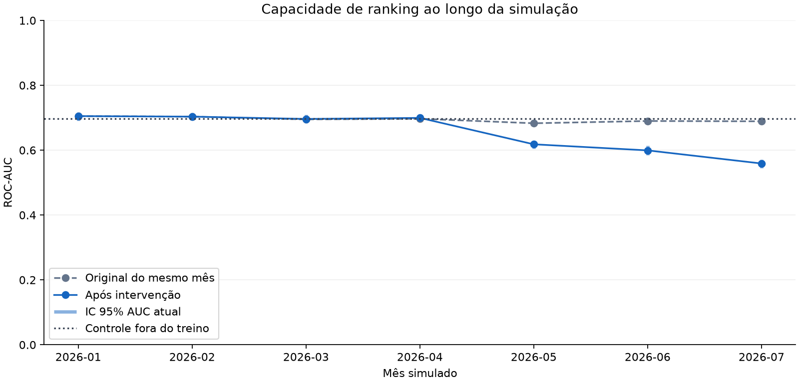
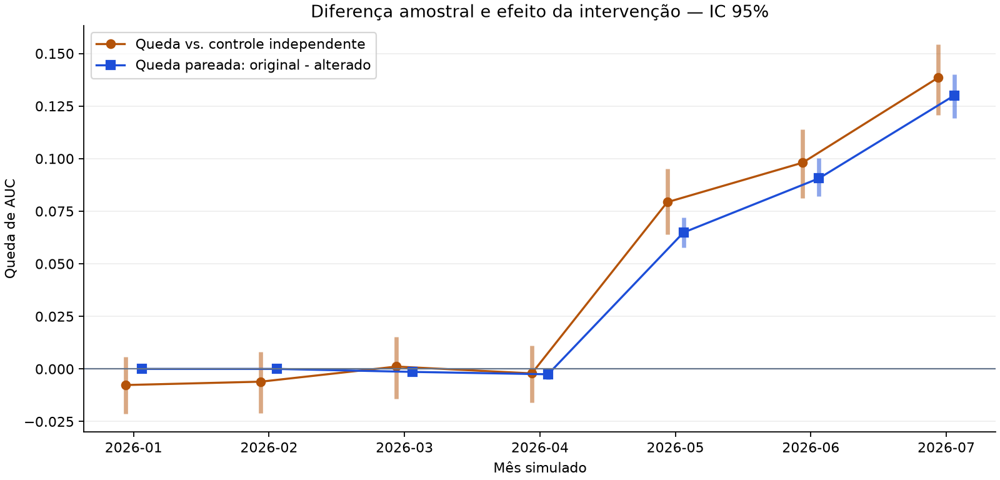
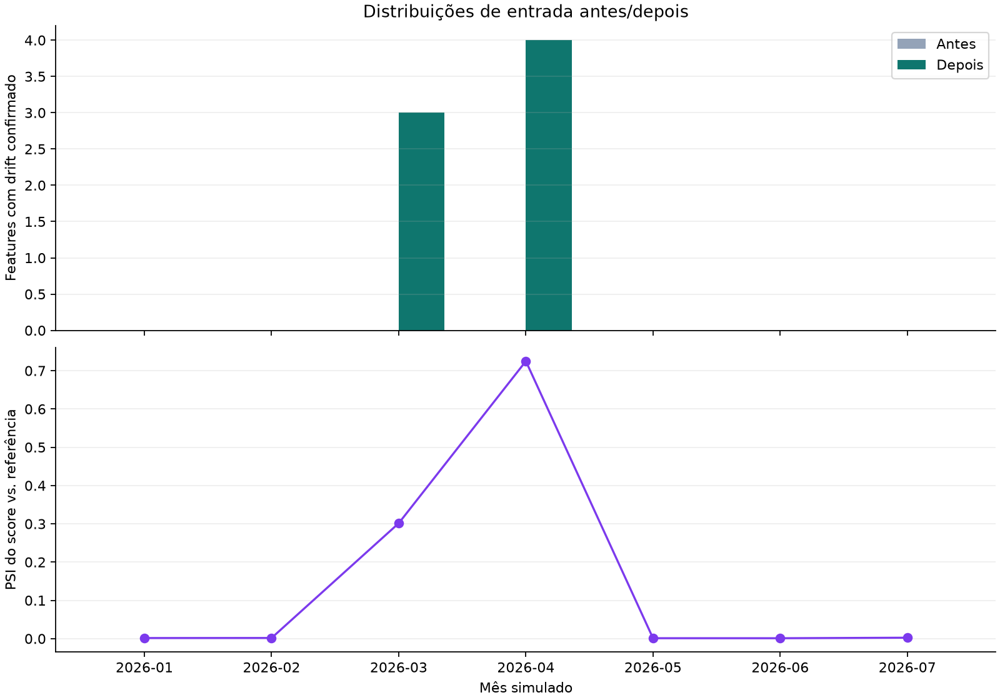

# Experimento consolidado de monitoramento

Esta é a seleção da última execução de `make analyze`. Modelo congelado e
controle fora do treino. Os meses representam uma simulação, não produção real.

| Mês | Cenário | AUC original | AUC atual | Queda vs. controle | Queda pareada | Drift share | Gate | Recomendação |
|---|---|---:|---:|---:|---:|---:|---|---|
| 2026-01 | stable | 0.7051 | 0.7051 | -0.0077 | 0.0000 | 0.0000 | OK | Continuar monitoramento regular |
| 2026-02 | stable | 0.7035 | 0.7035 | -0.0061 | 0.0000 | 0.0000 | OK | Continuar monitoramento regular |
| 2026-03 | data_drift | 0.6949 | 0.6963 | 0.0011 | -0.0014 | 0.1304 | WARN | Reforçar monitoramento e investigar mudanças nas entradas |
| 2026-04 | data_drift | 0.6970 | 0.6995 | -0.0021 | -0.0025 | 0.1739 | WARN | Reforçar monitoramento e investigar mudanças nas entradas |
| 2026-05 | concept_drift | 0.6830 | 0.6181 | 0.0793 | 0.0649 | 0.0000 | ALERT | Investigar degradação e avaliar retreinamento |
| 2026-06 | concept_drift | 0.6899 | 0.5993 | 0.0981 | 0.0906 | 0.0000 | ALERT | Investigar degradação e avaliar retreinamento |
| 2026-07 | concept_drift | 0.6890 | 0.5589 | 0.1385 | 0.1301 | 0.0000 | ALERT | Investigar degradação e avaliar retreinamento |

## Verificação dos cenários

- **stable**: 2 lotes; padrão esperado observado: True.
- **data_drift**: 2 lotes; padrão esperado observado: True.
- **concept_drift**: 3 lotes; padrão esperado observado: True.

Meses estáveis verificam alertas inesperados nesta amostra; dois meses não
estimam uma taxa geral de falsos positivos. Alterações nas features podem mudar
aprovação e Brier mesmo sem queda relevante de AUC. Relabel pode degradar a AUC
sem mudar X ou os scores dos mesmos registros.

## Antes e depois

As versões originais e alteradas têm os mesmos ids e ordem. A comparação contra
referência identifica diferenças já existentes; a comparação pareada isola a
intervenção nessa amostra. PSI original e alterado não são efeitos aditivos.
Intervalos da queda vs. controle usam bootstrap independente; os da queda
pareada mantêm os pares e estratificam pelo rótulo original. ICs são percentis
de 95% condicionais aos dados e ao procedimento, não prova de causa econômica.

## Decisões e limites

O gate usa métricas, nunca o nome do cenário simulado. Recomenda avaliar
retreinamento somente com rótulos suficientes e IC da queda acima do limite
operacional. Diagnósticos são suspeitas; nenhum modelo é treinado ou promovido.
Os detalhes e a justificativa estão nos HTMLs de cada mês e JSONs em `reports/gate/`.
Tabelas detalhadas: [meses](monthly.csv), [features antes/depois](features.csv) e
[proveniência e resultados](summary.json).

## Lotes não analisados

- corrupted: blocked.
