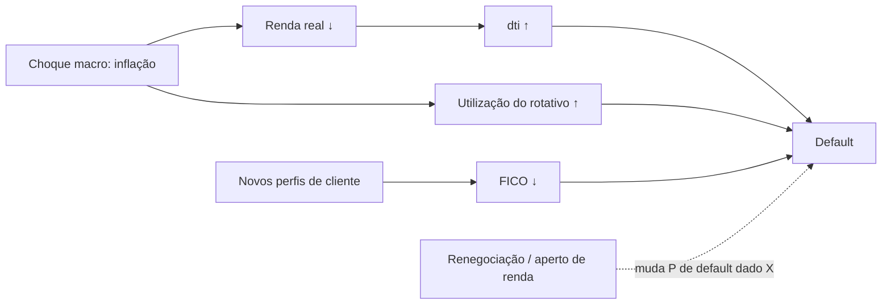

# Governança e proteção de dados (LGPD)

Plano de proteção de dados do modelo de crédito: quais dados pessoais existem, com que base legal são tratados, como são protegidos, por quanto tempo são guardados, como o viés é controlado e o que causa o drift. A versão resumida está nas seções [10. Governança e LGPD](../README.md#10-governança-e-lgpd) e [11. Análise causal](../README.md#11-análise-causal) do README.

> **Cenário.** Uma fintech brasileira (fictícia) usa o modelo para conceder crédito pessoal. O dataset é o público do Lending Club (EUA, Kaggle), sem nomes nem documentos, mas com campos que identificam indiretamente (cargo em texto livre, CEP parcial, estado). Os lotes de "produção" são **dados sintéticos baseados em regras**, derivados do pool de teste (Etapa 2). As decisões abaixo são as que valeriam num tratamento real.

> **Estado do documento.** Os itens 1–7, 9 e 11 estão completos. No item 8, a tabela do pool de produção vem de `reports/fairness/fairness_report.json` (`make fairness`, execução de 2026-10-03, modelo V2) e a tabela por lote vem de `make fairness-batches` sobre os sete lotes regenerados por `make simulate` (seed 42), que reproduzem as AUCs mensais da execução de referência mas não são byte-idênticos aos arquivos dela. Os números do item 10 são da execução de referência de 2026-10-21 (`source_revision` 72468ee; evidências em `docs/evidencias/`, commit c5d4029). O item 11 (auditoria) registra o que foi verificado e o que fica como política proposta.

## 1. Papéis

| Papel (LGPD Art. 5º) | Quem, no cenário | Responsabilidade neste projeto |
|---|---|---|
| **Controlador** | A fintech de crédito | Decide a finalidade (concessão de crédito) e responde pelo tratamento |
| **Operador** | Plataforma de ML (este pipeline) | Trata os dados em nome do controlador, nos limites da finalidade |
| **Encarregado (DPO)** | Encarregado nomeado pela fintech | Canal com titulares e ANPD; revisa o RIPD, as trocas de modelo e os relatórios de fairness (`make fairness`, `make fairness-batches`) |

Um modelo de crédito toma decisões automatizadas sobre todos os clientes. O caso Telekall (Aula 3 de Privacidade), em que a ausência de encarregado agravou a sanção, mostra por que o encarregado precisa existir e participar das trocas de modelo.

## 2. Inventário de dados

O arquivo bruto tem 151 colunas; o `prepare` lê **27** (`preprocessing.BASELINE_FEATURES` + `loan_status`, `issue_d`, `id`, `addr_state`):

| Classe | Colunas | Pessoal? | Tratamento |
|---|---|---|---|
| Identificador direto | `id`, `member_id`, `url` (contém o id) | Sim | `id` → `customer_id` pseudonimizado (item 2.1) e descartado; `member_id` e `url` **não são lidos** |
| Texto livre | `emp_title`, `title`, `desc` | Sim, e pode revelar terceiros ou saúde | **Não são lidos** (minimização) |
| Localização | `zip_code` (3 dígitos), `addr_state` | Quase-identificador | CEP **não é lido**; estado → **região do Census** (4 grupos), guardada só para auditoria de viés; o estado é descartado no `prepare` |
| Financeiros e de crédito | renda, dti, FICO, rotativo, atrasos, contas, consultas, tempo de emprego, finalidade, moradia | Sim | 23 features do modelo (`data_contract.MODEL_FEATURES`) |
| Condições do empréstimo | valor, prazo, data de emissão | Sim | Valor e prazo são features; a data (mês) ordena os lotes |
| Desfecho | `loan_status` | Sim | Vira o `target` e é descartado |
| Pós-desfecho e juros | pagamentos, recuperação, FICO final, `int_rate`, `grade` | Sim | **Não são lidos** (vazamento de rótulo e minimização; auditoria do notebook 01) |

**Não há dados sensíveis do Art. 11** (origem racial, religião, saúde, biometria, vida sexual...) nem sexo ou idade. A localização, porém, é **proxy** de raça e renda nos EUA (*redlining*); por isso a região é auditada (item 8) e nunca entra no modelo.

### 2.1 Anonimização × pseudonimização

- **Anonimização** (Art. 12): o dado não pode mais ser associado ao titular por meios razoáveis. Dado anonimizado deixa de ser dado pessoal.
- **Pseudonimização** (Art. 13, §4º): o dado só é associado ao titular com uma informação adicional mantida separadamente.

O `customer_id` é **pseudonimizado** (`prepare.pseudonymize`): SHA-256 de `"{sal}:{id}"` com um **sal secreto** (`PSEUDONYMIZATION_SALT` no `.env`, fora do git), truncado em 16 caracteres. Sem o sal, reverter exige força bruta; com o sal, basta recalcular o hash. Por isso a base continua sendo **dado pessoal**: o controlador consegue refazer a associação, e precisa conseguir, para atender os direitos do titular (item 6).

### 2.2 Risco de reidentificação (k-anonimato)

Um registro com k = 1 é único para aquela combinação de quase-identificadores. População de modelagem (1.348.099 empréstimos), com o que os parquet guardam. Cálculo: contagem de registros por combinação exata dos quase-identificadores (`region`, `issue_date`, `loan_amnt`, `annual_inc`, `fico_avg`) em `data/processed/reference.parquet` + `data/processed/production_pool.parquet`, reconferido em 2026-10-21; a faixa de US$ 5 mil é `loan_amnt` truncado a múltiplos de 5.000. Os dados ficam fora do git, por isso a tabela não tem relatório versionado:

| Quase-identificadores | Registros únicos (k = 1) | k < 5 |
|---|---|---|
| região + mês + valor exato | **6,4%** | 17,2% |
| região + mês + faixa de US$ 5 mil | 0,0% | 0,0% |
| região + mês + valor + renda | 54,8% | 79,9% |
| região + mês + valor + renda + FICO | 89,2% | 99,6% |

Consequências: mesmo sem nome nem documento, quem conhece valor, mês e renda de um cliente acha o registro. Por isso:
- CEP e estado saem do pipeline;
- Referência, pool e lotes ficam restritos ao time de modelagem, **fora do repositório** (`data/` no `.gitignore`);
- logs, métricas e relatórios **não carregam linhas**, só agregados e ids mascarados.

## 3. Base legal

| Tratamento | Base legal |
|---|---|
| Análise de risco para concessão de crédito | **Art. 7º, X — proteção do crédito**, complementada pela **Lei 12.414/2011** (Cadastro Positivo) |
| Uso dos dados informados na proposta | **Art. 7º, V — procedimentos preliminares de contrato**, a pedido do titular |
| Monitoramento, retreino e auditoria do modelo | Mesma finalidade (proteção do crédito): o retreino é tratamento **compatível** com a finalidade original, registrado no RIPD |
| Auditoria de viés por região | **Art. 6º, IX (não discriminação)** e **Art. 20, §2º** (auditoria de aspectos discriminatórios em decisão automatizada). A região serve só para medir, nunca para decidir |
| Decisão automatizada de crédito | **Art. 20**: o titular pode pedir revisão (item 6) |

O consentimento **não** é a base legal: ele poderia ser revogado a qualquer momento, o que inviabilizaria a análise de risco que a própria lei de proteção do crédito prevê.

Uso do dataset: dados públicos do Kaggle; o arquivo não é redistribuído pelo repositório, e cada integrante baixa a própria cópia.

## 4. Os 10 princípios da LGPD (Art. 6º) no projeto

| Princípio | Decisão concreta |
|---|---|
| **Finalidade** | Dados usados só para risco de crédito; o pipeline não exporta perfis para outros usos |
| **Adequação** | Features ligadas ao comportamento de crédito e às condições do empréstimo, conhecidas na concessão |
| **Necessidade** (minimização) | 27 das 151 colunas lidas; texto livre, CEP, `member_id` e `url` nunca lidos; estado reduzido a região; `customer_id` fora do modelo |
| **Livre acesso** | O titular pode consultar os dados e o score (item 6) |
| **Qualidade dos dados** | Contrato Pandera + regras de lote; lote inválido vai para a quarentena e não é pontuado (`make demo-contract`) |
| **Transparência** | Model card, coeficientes da regressão logística, notebooks de estudo, este documento |
| **Segurança** | Sal fora do repositório; dados fora do git; logs e relatórios sem identificadores |
| **Prevenção** | Monitoramento de drift e performance evita decisões erradas em série (degradação silenciosa) |
| **Não discriminação** | Região fora do modelo; aprovação por região medida no pool (`make fairness`) e por lote (`make fairness-batches`); **guardrail** de promoção proposto para eventual retreino, não implementado (item 8) |
| **Responsabilização e prestação de contas** | Commits semânticos, relatórios de contrato/fairness/causal, runs do MLflow (Etapa 3), post-mortem |

## 5. Privacy by Design (7 princípios de Cavoukian)

| Princípio | Como aparece |
|---|---|
| Proativo, não reativo | O contrato bloqueia o dado ruim **antes** do score; o drift é detectado antes de o rótulo chegar |
| Privacidade como padrão | Logs mascaram identificadores por padrão (`logger.redact_identifiers`); telemetria de terceiros (MLflow, Evidently, GE, NannyML) **desligada por padrão** em `src/credit_scoring_observability/__init__.py`; colunas de texto livre fora da lista de leitura |
| Privacidade embutida no design | Pseudonimização e generalização (estado → região) na primeira etapa (`prepare`), antes de qualquer outro processamento |
| Funcionalidade total (soma positiva) | Monitoramento completo, inclusive fairness, sem identificadores em claro: as métricas são agregados por lote |
| Segurança ponta a ponta | Quarentena com prazo e descarte (`make purge-quarantine`); retenção de 90 dias configurada na stack (`monitoring/loki/loki.yml`, `monitoring/tempo/tempo.yml`, `docker-compose.yml`) |
| Visibilidade e transparência | Contratos, parâmetros, decisões, relatórios e notebooks versionados |
| Respeito ao titular | Direitos do item 6 atendíveis com a pseudonimização reversível pelo controlador |

## 6. Direitos do titular (Art. 18 e 20)

| Direito | Como é atendido |
|---|---|
| Confirmação e acesso | O controlador recalcula o hash com o sal e localiza o registro e o score |
| Correção | Correção na origem; o próximo lote passa pelo contrato com o dado corrigido |
| Anonimização, bloqueio ou eliminação | Eliminação na origem e nos lotes retidos; métricas e relatórios agregados não contêm o titular |
| Informação sobre compartilhamento | Não há compartilhamento no escopo do pipeline |
| **Revisão de decisão automatizada (Art. 20)** | Explicação pelos termos de maior contribuição da regressão logística (coeficientes do pipeline); **revisão humana** na faixa próxima do threshold (0,20) e sob pedido do titular |

## 7. Retenção e descarte

| Dado | Prazo | Como é aplicado |
|---|---|---|
| Arquivo bruto do Kaggle | Não é redistribuído | Cada integrante baixa; fora do git |
| Referência e pool (`data/processed/`) | Enquanto o modelo treinado neles estiver em uso + auditoria | Política do controlador; fora do git |
| Lotes de produção | Enquanto usados em treino ou auditoria. Referências legais: 5 anos para informação negativa (CDC Art. 43, §1º) e 15 anos para o histórico do Cadastro Positivo (Lei 12.414/2011) | Política do controlador |
| **Quarentena** (lotes bloqueados) | **30 dias** (`retention.quarantine_days`) | `make purge-quarantine` (`retention.py`, com `--dry-run`) apaga o lote; o relatório do contrato fica (agregado, ids mascarados) |
| **Logs** (Loki) e **traces** (Tempo) | **90 dias** | Configurado: `retention_period: 2160h` com `compactor.retention_enabled: true` em `monitoring/loki/loki.yml`; `block_retention: 2160h` em `monitoring/tempo/tempo.yml` |
| Métricas (Prometheus) | **90 dias** | Configurado: `--storage.tsdb.retention.time=90d` em `docker-compose.yml`. Pushgateway (só o último snapshot por lote) e MLflow não têm retenção configurada |
| Relatórios agregados, decisões, runs do MLflow | Mantidos | Não contêm dados de titulares, só agregados |

**Sanções** (Art. 52): advertência; multa de até 2% do faturamento no Brasil, limitada a R$ 50 milhões por infração; publicização da infração; bloqueio ou eliminação dos dados.

## 8. Viés e fairness

O atributo auditado é a **região** do cliente (Census dos EUA: Northeast, Midwest, South, West), derivada do estado (`fairness.py`, fairlearn `MetricFrame`). A decisão é "negar" quando o score passa do threshold (0,20).

### Situação do modelo V2 (pool de produção, 269.620 empréstimos; `make fairness`)

| Região | Empréstimos | Aprovação | TPR (inadimplentes negados) | FPR (bons pagadores negados) | Default observado |
|---|---|---|---|---|---|
| Midwest | 47.209 | 59,1% | 63,8% | 35,2% | 19,9% |
| Northeast | 54.484 | 58,6% | 63,4% | 35,8% | 20,4% |
| South | 95.583 | 59,6% | 62,2% | 34,8% | 20,7% |
| West | 72.344 | 58,5% | 64,1% | 36,2% | 18,8% |

**Razão de impacto desigual: 0,983** (regra dos 4/5: 0,8); diferença máxima de FPR entre regiões: 1,5 p.p. Não há disparidade relevante entre regiões.

### Em produção (proposta, não integrada)

O módulo `approval_disparity` (`fairness.py`) permite medir a razão por região
sem rótulos, mas essa medição não está integrada à CLI mensal. O que existe é
uma política proposta de **guardrail** para eventual challenger: não promover
se piorar a razão em mais de 0,05. Não há promoção automática implementada.

### Fairness por lote nos meses simulados

Medição feita por `make fairness-batches` (`reports/fairness/fairness_by_batch.json`)
sobre os sete lotes sintéticos regenerados por `make simulate` (seed 42), com
os rótulos de cada lote e o threshold de 0,20. As AUCs por mês coincidem com
as da execução de referência; os arquivos não são byte-idênticos aos dela.
Não está integrada ao pipeline mensal (`make monitor`), que não publica
métrica nem alerta de fairness.

| Mês | Cenário | Aprovação por região (mín.–máx.) | Impacto desigual | Diferença de FPR | Diferença de TPR |
|---|---|---|---|---|---|
| 2026-01 | estável | 58,6%–60,0% | 0,977 | 2,4 p.p. | 0,7 p.p. |
| 2026-02 | estável | 57,7%–60,8% | 0,949 | 2,4 p.p. | 3,2 p.p. |
| 2026-03 | covariate shift (0,6) | 34,5%–36,6% | 0,943 | 2,1 p.p. | 0,8 p.p. |
| 2026-04 | covariate shift (1,0) | 23,1%–26,5% | 0,875 | 3,4 p.p. | 4,7 p.p. |
| 2026-05 | concept drift (0,35) | 58,2%–60,4% | 0,963 | 3,1 p.p. | 1,0 p.p. |
| 2026-06 | concept drift (0,55) | 56,2%–60,5% | 0,929 | 5,3 p.p. | 5,3 p.p. |
| 2026-07 | concept drift (0,75) | 57,6%–59,5% | 0,968 | 1,9 p.p. | 2,8 p.p. |

Leitura: todos os meses ficam acima de 0,8 (regra dos 4/5). O menor valor é o
de abril (covariate shift com intensidade 1,0), 0,875, com a aprovação caindo
para 23,1%–26,5%: o deslocamento das entradas afeta as regiões de forma
desigual mesmo com a AUC estável (0,6995 nesse mês). Em maio–julho (relabel) a
razão oscila entre 0,929 e 0,968 sem tendência, com as diferenças de FPR e TPR
chegando a 5,3 p.p. em junho. Os meses são cenários sintéticos; os valores
descrevem o comportamento do modelo sob as intervenções configuradas, não uma
carteira real.

### Mitigação avaliada e não adotada (`mitigation.py`)

Thresholds por região com **paridade de FPR**, determinísticos: a meta é o FPR global do threshold atual (35,5%), e o threshold de cada região é o quantil (1 − meta) do score dos seus bons pagadores. A estimativa é feita numa metade do pool e a avaliação na outra:

| | Aprovação | Default entre aprovados | Impacto desigual | Diferença de FPR |
|---|---|---|---|---|
| Threshold único (0,20) | 59,1% | 12,5% | 0,980 | 1,4 p.p. |
| Por região (0,198–0,203) | 59,2% | 12,5% | 0,984 | 0,5 p.p. |

**Decisão: não adotar** (`adopted_in_production: false`).
1. O ganho é desprezível: os thresholds por região ficariam quase iguais ao global.
2. Usar a região explicitamente na decisão é **tratamento diferenciado por um proxy de raça**, mais difícil de justificar (Art. 6º, IX) do que um modelo que não a usa. A adoção dependeria de avaliação jurídica.
3. O `ThresholdOptimizer` do fairlearn foi descartado: ele sorteia a decisão dentro do grupo, o que é indefensável diante do pedido de revisão do Art. 20.

O que se adota é a **fairness through unawareness** no modelo (a região não é feature), a medição por lote fora do pipeline mensal (`make fairness-batches`), um guardrail proposto para eventual retreino e revisão humana perto do threshold. Isso não constitui uma esteira de retreinamento implementada.

## 9. Relatório de Impacto (resumo de RIPD, Art. 38)

| Risco | Probabilidade | Impacto | Medida |
|---|---|---|---|
| Decisão errada em série por degradação silenciosa do modelo | Alta (a economia muda) | Alto | Drift + performance + gate (Etapa 2); alertas (Etapa 3); retreino não implementado, com guardrails propostos para quando existir |
| Discriminação indireta por localização | Baixa entre regiões (0,983 no pool; 0,875–0,977 por lote) | Alto | Localização fora do modelo; medição por lote via `make fairness-batches`; guardrail proposto para eventual retreino; revisão humana |
| Dado corrompido pontuado | Média | Alto | Contrato + regras de lote; quarentena; exit 2 no pipeline |
| Reidentificação por quase-identificadores | Média (6,4% únicos com região + mês + valor) | Alto | CEP e estado fora; dados fora do git e restritos; nenhum dado de linha em logs, métricas e relatórios |
| Reidentificação a partir de logs/relatórios | Baixa | Alto | Pseudonimização com sal; mascaramento em logs e relatórios; teste automatizado de ausência de id (Etapa 3) |
| Vazamento do sal | Baixa | Alto | `.env` fora do git; trocar o sal invalida a associação |
| Texto livre com dados de terceiros ou de saúde | Alta se lido | Alto | `emp_title`, `title` e `desc` nunca lidos |
| Retenção excessiva | Média | Médio | Quarentena 30 dias com descarte; logs/traces/métricas 90 dias em configuração |
| Uso para outra finalidade no retreino | Baixa | Médio | Eventual retreino só com lotes aprovados no contrato, mesma finalidade (política; não há retreino implementado) |
| Telemetria de bibliotecas enviando metadados a terceiros | Média (padrão das libs) | Baixo | Opt-out centralizado no `__init__.py` do pacote |

## 10. Análise causal do problema

A pergunta da diretoria — "o modelo está tomando decisões erradas por causa da economia?" — tem respostas diferentes em cada momento. O projeto separa **quem chega** (covariate shift) de **o que acontece com o mesmo perfil** (concept drift).

### DAG de hipóteses

As setas cheias mudam **quem** chega (covariate shift). A tracejada muda **o que acontece** com o mesmo perfil (concept drift). As hipóteses são do grupo; o DAG não foi aprendido dos dados.

### Sensibilidade por restauração de marginais

O comando `make causal` avalia grupos relacionados: renda/DTI, rotativo e FICO.
DTI representa comprometimento de renda com dívidas; não é reconstruído pela
razão entre um saldo de dívida e a renda anual disponível nas features.

O mapeamento por quantis é monotônico em cada coluna. Agrupar colunas não
garante preservar correlações lineares, distribuição conjunta ou equações
econômicas. O DAG acima é uma hipótese ilustrativa e não é identificado por
esse procedimento. Os diagnósticos são compatibilidade/suspeita, sem provar
causa econômica ou autorizar retreinamento.

A execução final usa o mesmo controle reservado da avaliação de performance.
Consulte [resultados e limites](causal-analysis.md),
[linha do tempo](incident-timeline.md) e [evidências](evidencias/README.md).

### Resultados da execução de referência

Valores de `docs/evidencias/causal/causal_analysis.json` (execução de
2026-10-21). A AUC de referência é a do controle reservado, 0,6974; a coluna
"após restaurar" usa a combinação dos três grupos (renda+dívida, rotativo e
FICO). Janeiro e fevereiro não têm sinal relevante (PSI do score 0,0015 e
0,0017; AUC 0,7051 e 0,7035).

| Mês | PSI do score | AUC | PSI após restaurar | AUC após restaurar | Diagnóstico |
|---|---|---|---|---|---|
| 2026-03 | 0,3014 | 0,6963 | 0,0008 | 0,6948 | covariate shift compatível |
| 2026-04 | 0,7248 | 0,6995 | 0,0009 | 0,6970 | covariate shift compatível |
| 2026-05 | 0,0011 | 0,6181 | 0,0010 | 0,6184 | concept drift suspeito |
| 2026-06 | 0,0010 | 0,5993 | 0,0011 | 0,5993 | concept drift suspeito |
| 2026-07 | 0,0024 | 0,5589 | 0,0023 | 0,5589 | concept drift suspeito |

Em março e abril, restaurar os três grupos recupera 99,7% e 99,9% do
deslocamento do PSI (só renda+dívida: 69,8% e 70,2%), e a AUC fica
praticamente estável (0,6948 e 0,6970). Em
maio–julho o score quase não se desloca, a AUC cai mais do que o limite de
0,05 e a restauração não a recupera: o sinal é compatível com mudança de
P(Y|X), mas o procedimento não a demonstra. Os diagnósticos são hipóteses de
sensibilidade sobre cenários sintéticos. Identificar uma causa econômica real
exigiria dados de intervenção (uma política de crédito alternativa aplicada a
parte dos clientes ou um desenho quase-experimental), não apenas a observação
dos lotes; o gate continua sendo a única fonte de recomendação operacional.

## 11. Auditoria de privacidade

| Verificação | Responsável | Estado | Evidência |
|---|---|---|---|
| Sal de pseudonimização fora do git | Etapa 1 | ✅ | `.env` no `.gitignore`; `prepare` avisa se o sal padrão estiver em uso; `prepare_report.json` registra `default_salt_used` |
| `id` original descartado; `customer_id` determinístico e salgado | Etapa 1 | ✅ | `tests/test_prepare.py` (pseudonimização, colunas de saída) |
| Estado e CEP fora dos dados preparados | Etapa 1 | ✅ | `tests/test_prepare.py::test_outputs_have_the_shared_schema` |
| `customer_id` mascarado nos relatórios de contrato | Etapa 1 | ✅ | `tests/test_validate.py::test_examples_are_masked`, `test_enforce_quarantines_and_raises` |
| Logs mascaram identificadores antes de gravar | Etapa 1 | ✅ | `tests/test_logger.py` |
| Telemetria das bibliotecas desligada antes do import | Etapa 1 | ✅ | `src/credit_scoring_observability/__init__.py` |
| Quarentena com descarte em 30 dias | Etapa 4 | ✅ | `retention.py`, `tests/test_governance.py::test_purge_removes_only_expired` |
| Nenhum `customer_id` em logs do pipeline, métricas e spans (ponta a ponta) | Etapa 3 | ✅ | `tests/test_observability.py::test_real_batches_continue_after_block_and_failure` (ids ausentes em `.prom` e nos JSONs de monitoramento; contrato sem `examples`), `tests/test_observability.py::test_stage_restores_context_and_redacts_exception` (span só com `error.type`, sem mensagem), `tests/test_analysis.py::test_months_are_scored_after_blocked_demo_and_reports_have_no_ids`, `tests/test_drift.py::test_html_and_json_use_only_allowed_columns_and_strict_aggregate_data`, `tests/test_logger.py::test_redaction_runs_before_file_and_renderer`. O span raiz `pipeline.batch` (`run_batch.py`, `record_exception=False`) e o envio ao MLflow (`observation.py`, só agregados) são garantidos por código, sem teste pytest; `scripts/check_observability.py` confirma na stack que trace e logs foram entregues, mas não inspeciona o conteúdo dos spans |
| Retenção de 90 dias na configuração de Loki, Tempo e Prometheus | Etapa 3 | ✅ | `monitoring/loki/loki.yml` (`retention_period: 2160h`, `compactor.retention_enabled: true`), `monitoring/tempo/tempo.yml` (`block_retention: 2160h`), `docker-compose.yml` (`--storage.tsdb.retention.time=90d`). Retenção configurada, não verificada em execução; Pushgateway e MLflow não têm retenção configurada (snapshots substituídos por lote; runs só com agregados, item 7) |
| Guardrail de fairness no retreino | Etapa 2 | — | Não há retreino implementado: `registry.py` só conhece o alias `production` (`NotImplementedError` para os demais) e `gate.py` só recomenda ("nenhum modelo é retreinado ou promovido"). Fica como política proposta (item 8) |
| Seleção pública em `docs/evidencias` sem `customer_id` nem sal | Etapa 3 | ✅ | `scripts/freeze_evidence.py` (`freeze`): republica o contrato só com contagens agregadas, sem `examples`, e levanta `ValueError` se algum `customer_id` de `production_pool.parquet` ou `reference_sample.parquet`, o sal do `.env` ou um caminho local aparecer nos arquivos. Reconferido em 2026-10-21 por leitura dos 30 arquivos de texto: interseção vazia com os 369.619 ids da amostra de referência (99.999) e do pool (269.620); `reference.parquet` completo não entra na verificação; sal ausente. Sem teste pytest para o script |
